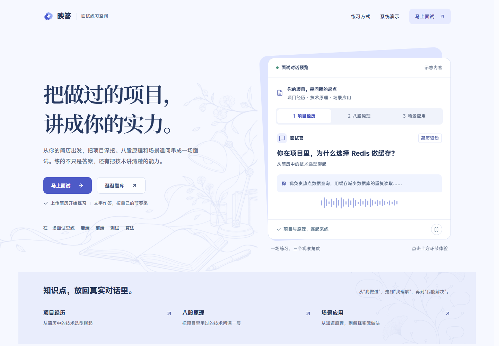
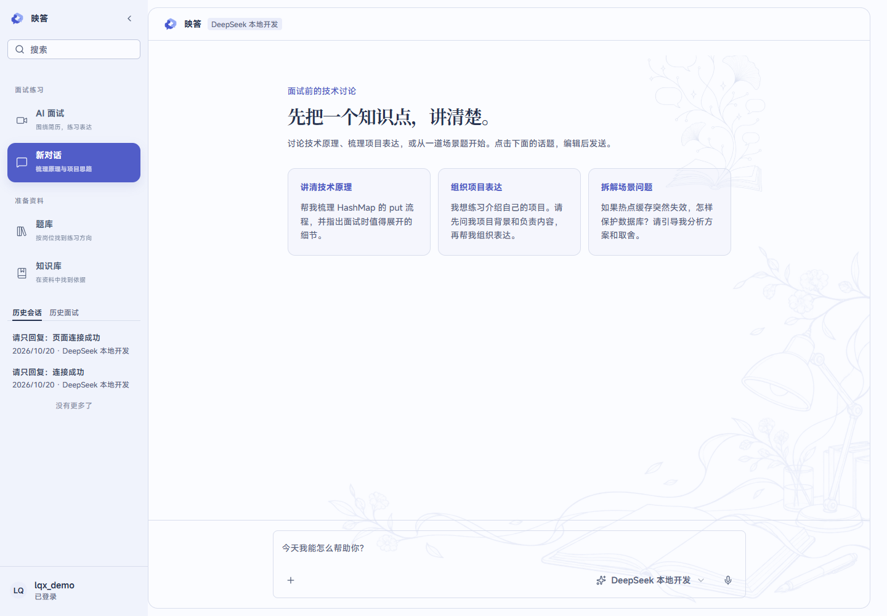
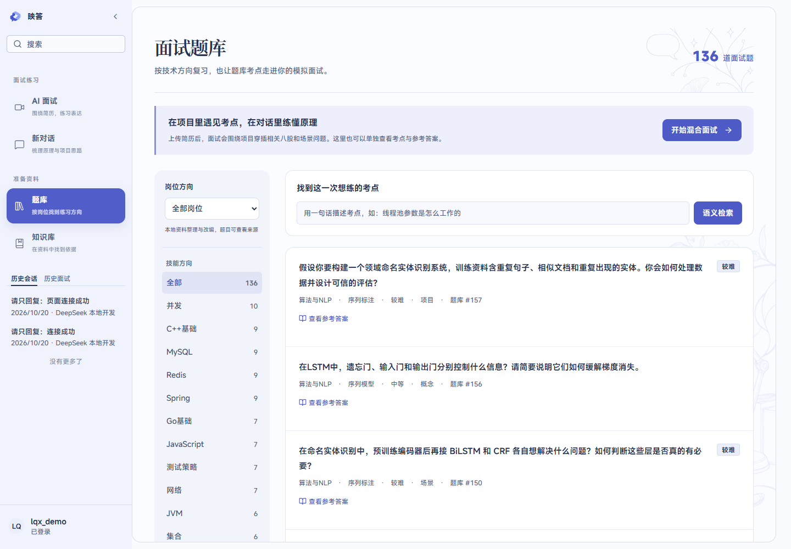
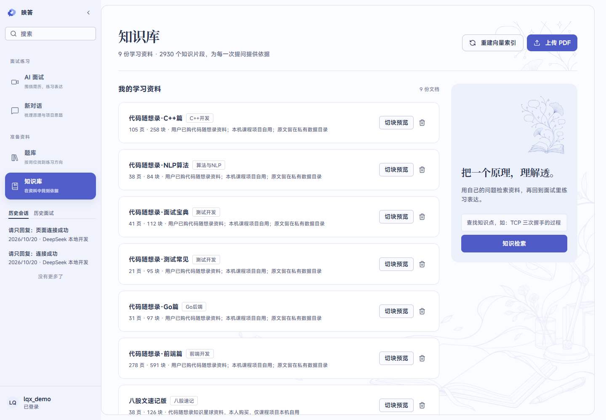
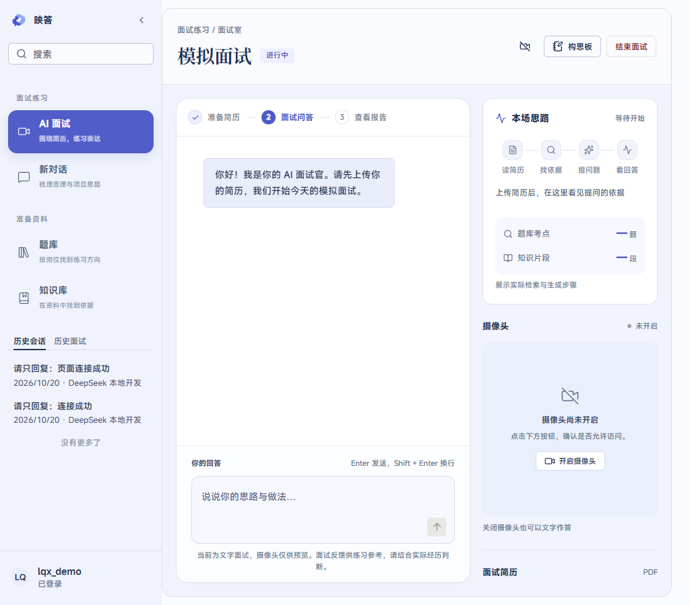
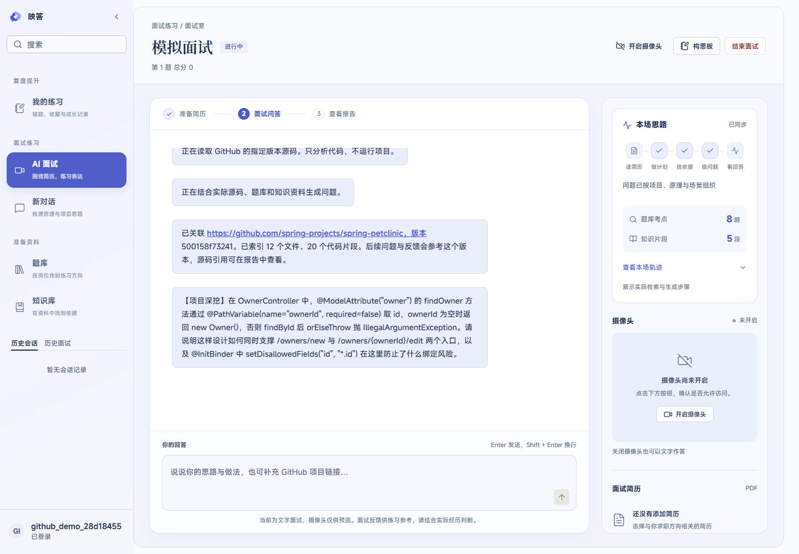
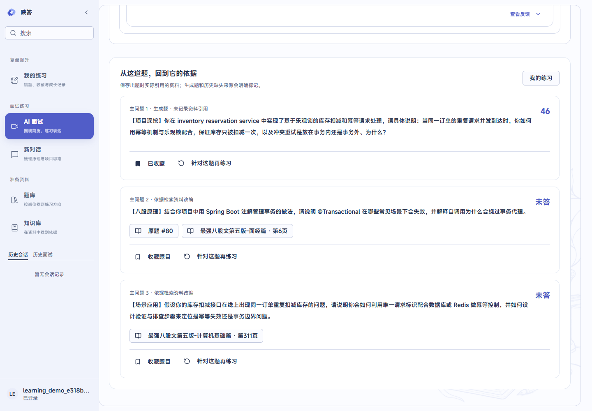
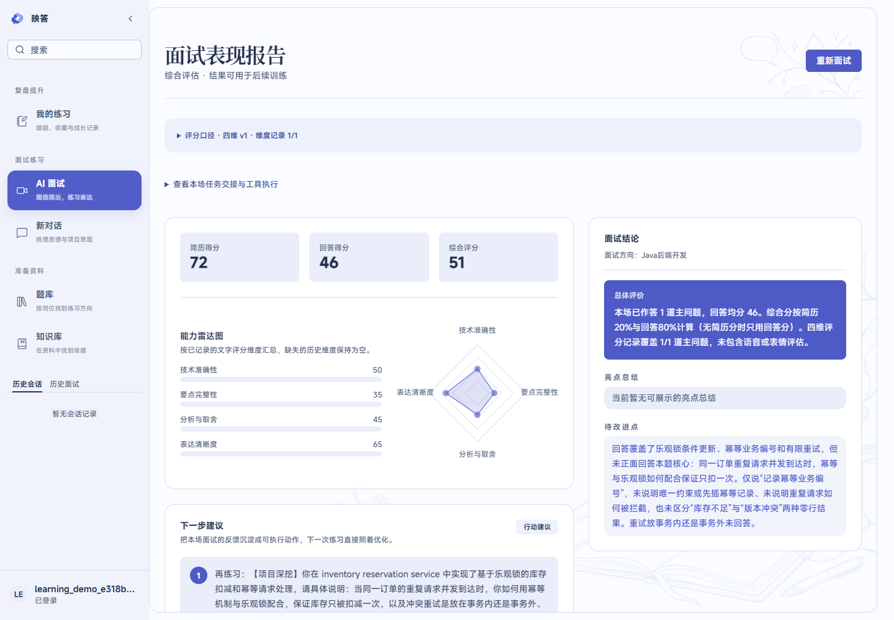
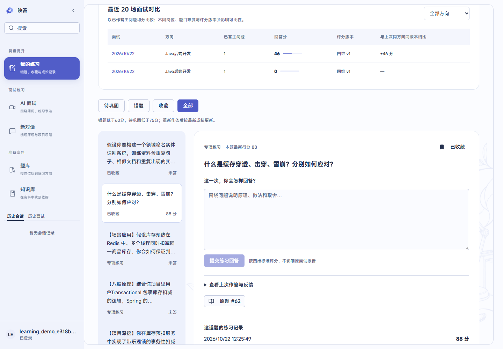

<div align="center">


# 映答 Yingda

**AI 模拟面试与练习平台** —— 简历驱动出题 · 双源 RAG 溯源 · 四维评分 · GitHub 源码面试

[](https://openjdk.org/)
[](https://spring.io/projects/spring-boot)
[](https://docs.spring.io/spring-ai/reference/)
[](https://docs.langchain4j.dev/)
[](https://react.dev/)
[](https://www.typescriptlang.org/)
[](https://vite.dev/)

[](https://www.mysql.com/)
[](https://www.mongodb.com/)
[](https://redis.io/)
[](https://docs.docker.com/compose/)
[](LICENSE)
[](https://github.com/lishuangqiang/AI-Meeting)

[功能特性](#-功能特性) · [界面截图](#-界面截图) · [演示视频](#-演示视频) · [快速开始](#-快速开始复现指南) · [分支规范](#-分支与提交规范)

</div>

---

映答是一个以 **Java 为业务主干、智能体与 RAG 作为增强能力** 的模拟面试系统：上传 PDF 简历（或直接发送一个公开 GitHub 仓库链接），系统会结合**真题题库向量检索**与**知识库文档检索**出题，逐题给出带来源追溯的追问与评分，最终产出四维评分报告和跨场次学习闭环。

> 本项目在开源项目 [AI-Meeting](https://github.com/lishuangqiang/AI-Meeting)（MIT License）基础上二次开发，二次开发范围见 [与上游的差异](#-与上游的差异)。

## 🎬 演示视频

63 秒完整流程：品牌动画 → 首页 → 上传简历 → RAG 出题 → 作答与追问 → 评分报告。

**[▶ 点击观看 yingda-demo.mp4](frontend/public/videos/yingda-demo.mp4)**（GitHub 内置播放器可直接播放；该视频同时部署在系统首页）

## ✨ 功能特性

### 模拟面试

- **简历驱动混合出题** — 上传 PDF 简历后按「项目深挖 / 八股原理 / 场景应用」三类混合出题，题目与候选人经历深度关联，支持追问深挖。
- **GitHub 源码面试** — 在面试输入框直接发送公开 GitHub 仓库 / 目录 / 文件链接，系统拉取源码、建立代码块索引并据此出题，报告中的题目来源可跳回 GitHub 原文件原行号。
- **双源 RAG 检索增强** — 出题、追问、评分前先检索「真题题库」（MySQL + Redis Stack 向量索引）与「知识文档库」（PDF 切块向量化），题目可溯源到题库 ID、原题、参考答案与 PDF 页码。
- **执行过程可视化** — 面试室内的「本场思路」面板实时展示 简历分析 → 检索 → 提问 → 回答 四阶段、真实召回数量、工具耗时与编号轨迹。

### 评分与学习闭环

- **四维评分** — 每道题按 准确性 / 完整性 / 推理 / 表达 四个维度打分，服务端加权计算，同一答案重复提交幂等。
- **逐题来源快照** — 每道题保存出题时的来源快照（原题、知识片段、代码位置），报告中可展开查看依据。
- **错题与收藏** — 题目可收藏、标记错题 / 待巩固，进入「我的练习」。
- **专项再练习** — 按维度（如推理薄弱）发起专项练习，重放历史题目与来源；支持最近 20 场跨场次对比。

### 题库与知识库

- **六岗位 136 题真题库** — 覆盖 Java 后端 / 前端 / C++ / Go / 测试 / NLP 算法，含参考答案、评分要点、技能标签与来源标注。
- **知识文档管道** — 上传 PDF（支持加密文档）自动切分、批量向量化、独立索引；内置检索调试接口。
- **联网扩充管道** — 一键联网搜索真实面经素材 → 模型编题 → 查重 → 入库 → 自动向量化（DeepSeek Search 主用，Tavily 备用）。

### 基础能力

- **AI 对话** — 多模型接入（OpenAI 兼容协议，DeepSeek 默认），SSE 流式输出，MongoDB 聊天历史。
- **账号体系** — 注册登录、个人资料、面试记录管理（保留完整 CRUD）。

## 📸 界面截图

| 首页 | AI 对话 |
|:---:|:---:|
|  |  |

| 题库（六岗位 · 语义检索） | 知识库（PDF 切块 · 向量检索） |
|:---:|:---:|
|  |  |

| 面试室（执行轨迹侧栏） | GitHub 源码面试 |
|:---:|:---:|
|  |  |

| 逐题来源追溯 | 四维评分报告 |
|:---:|:---:|
|  |  |

| 专项再练习工作台 | |
|:---:|:---:|
|  |  |

## 🏗️ 技术架构

| 层 | 技术 |
|---|---|
| 后端 | Java 17 · Spring Boot 3.4 · Spring AI 1.0 · LangChain4j 1.14 · MyBatis-Plus · Sa-Token · LiteFlow |
| 前端 | React 19 · TypeScript 5.9 · Vite 7 · Tailwind CSS · shadcn/ui · Recharts |
| 存储 | MySQL 8.4（业务与题库） · MongoDB 7（会话 / 消息 / 学习轨迹） · Redis Stack 7.2（缓存 + RediSearch 向量检索） |
| 模型 | DeepSeek（对话 / 出题 / 评分，OpenAI 兼容） · 通义千问 text-embedding-v3（向量化） · DeepSeek Search / Tavily（联网搜索） |
| 交付 | Docker Compose 一键起基础设施 · Maven Wrapper · Vitest + Maven Surefire |

```
简历/仓库链接 → 简历分析(工具选择) → 双源RAG检索 ─┐
                                                  ├→ 出题 → 提问⇄作答 → 追问决策 → 四维评分 → 报告
知识库PDF管道 → 切块/向量化 → Redis向量索引 ──────┘            （执行轨迹全程落 Redis，可恢复）
```

## 🚀 快速开始（复现指南）

### 前置条件

- JDK 17+（`JAVA_HOME` 已配置）
- Node.js ≥ 20
- Docker Desktop（或等效 Docker 环境）
- 一个 **DeepSeek API Key**（必需，[获取](https://platform.deepseek.com)）；一个**阿里云百炼 DashScope Key**（开启 RAG 时必需，[获取](https://bailian.console.aliyun.com)）

### 步骤

```bash
# 1. 克隆仓库
git clone https://github.com/Richard110206/interview-pilot.git
cd interview-pilot

# 2. 准备环境变量（模板已给出全部变量与说明）
mkdir -p .local
cp deploy/runtime.env.example .local/runtime.env
#    编辑 .local/runtime.env，填入：
#    - MYSQL_PASSWORD       本地数据库密码（自定义）
#    - SPRING_AI_OPENAI_API_KEY   DeepSeek Key（必需）
#    - DASHSCOPE_API_KEY    百炼 Key（开启 RAG 必需）
#    .local/ 已被 .gitignore 排除，密钥不会进入版本库
```

**方式一：Windows 一键启动**

```powershell
powershell -ExecutionPolicy Bypass -File scripts/start-dev.ps1
```

脚本会依次：启动 MySQL / MongoDB / Redis Stack（首次自动建库建表并导入种子数据）→ 构建并启动后端（:8002）→ 启动前端（:5173）。

**方式二：macOS / Linux 手动启动**

```bash
# 3. 启动基础设施（首次运行自动初始化 schema 与种子数据）
docker compose --env-file .local/runtime.env -f deploy/compose.local.yml up -d --wait

# 4. 构建并启动后端（加载环境变量）
cd backend
set -a; source ../.local/runtime.env; set +a
./mvnw -pl admin -am package -DskipTests
java -Dfile.encoding=UTF-8 -jar admin/target/xunzhi-admin-*.jar

# 5. 启动前端（新终端）
cd frontend && npm install && npm run dev
```

### 访问

- 前端：<http://127.0.0.1:5173> ，演示账号 `demo / 123456`（也可自行注册）
- 后端健康检查：<http://127.0.0.1:8002/actuator/health>

### 复现验证清单

1. 登录后进入「AI 对话」，选择模型发送消息，确认 SSE 流式回复；
2. 「题库」页切换岗位标签、输入语义查询（如「HashMap 红黑树」），确认检索结果；
3. 「知识库」上传一份 PDF，等待切块与向量化完成；
4. 「开始面试」上传简历 PDF，确认三道混合题型均带来源标注，作答后获得四维评分；
5. 结束面试后查看报告：逐题来源、雷达图、错题标记与「我的练习」入口。

### 常见问题

- **MySQL 中文乱码**：导入 SQL 必须带 `--default-character-set=utf8mb4`（Compose 已内置 utf8mb4，手工导入时注意）；
- **Redis 报向量索引错误**：确认使用 `redis/redis-stack-server` 镜像（Compose 已指定），普通 Redis 无 RediSearch；
- **不使用 RAG**：`.local/runtime.env` 中把 `XUNZHI_QUESTION_BANK_RAG_ENABLED` / `XUNZHI_KNOWLEDGE_RAG_ENABLED` 置为 `false`，仅对话与出题仍可运行。

## 🌿 分支与提交规范

参考主流开源项目的 Conventional 分支 / 提交约定：

| 分支 | 用途 |
|---|---|
| `main` | 稳定可运行版本，保护分支，只接受合并 |
| `feat/<scope>-<description>` | 新功能，如 `feat/question-bank-rag` |
| `fix/<scope>-<description>` | 缺陷修复，如 `fix/model-options-parsing` |
| `docs/<description>` | 文档，如 `docs/readme-badges` |
| `refactor/<scope>-<description>` | 重构，如 `refactor/interview-state-machine` |
| `chore/<description>` | 构建 / 依赖 / 杂务 |

提交信息使用 [Conventional Commits](https://www.conventionalcommits.org/zh-hans/)：`feat: ...`、`fix: ...`、`docs: ...`、`refactor: ...`、`test: ...`、`chore: ...`。工作流：从 `main` 切出短生命周期分支 → 开发并自测 → 合回 `main`。

## 🔄 与上游的差异

本项目基于 [AI-Meeting](https://github.com/lishuangqiang/AI-Meeting) 与 [AI-Meeting-Frontend](https://github.com/lishuangqiang/AI-Meeting-Frontend) 二次开发（上游 MIT License，版权与许可保留）。主要自主改动：

- **Java 直连模型面试模式**：出题 / 提问 / 评分 / 追问改为 Java 直接调用 OpenAI 兼容接口，摆脱云端工作流依赖（可切回原模式）；
- **双源 RAG**：LangChain4j + Redis Stack 向量检索，题库与知识文档双索引、逐题来源溯源；
- **四维评分与学习闭环**：准确性 / 完整性 / 推理 / 表达四维打分、错题收藏、专项再练习、跨场次比较（MongoDB 持久化）；
- **GitHub 源码面试**：对话内直接发送仓库链接，REST + smart HTTP + codeload 拉取代码建索引出题；
- **联网题库扩充管道**（DeepSeek Search / Tavily）、**六岗位题库**（136 题）、**全站界面重塑**（映答品牌、字体系统、白描装饰）；
- **独立开发 Compose**、环境变量模板、种子数据脱敏、若干上游缺陷修复（模型选项解析、旧测试构造等）。

逐轮开发记录见 [docs/devlog](docs/devlog)。快照来源与校验信息见 [docs/backend-source.json](docs/backend-source.json)、[docs/frontend-source.json](docs/frontend-source.json)。

## 📁 项目结构

```
interview-pilot/
├── backend/          # Spring Boot 后端（Maven 多模块：admin 主应用）
├── frontend/         # React 19 + Vite 前端
├── deploy/           # Docker Compose 与 runtime.env 模板
├── scripts/          # 一键启动脚本
├── design/           # 品牌资产与生成提示词
└── docs/             # 截图、开发日志、来源快照元数据
```

## ⚠️ 已知限制

- 语音面试与表情分析沿用上游云端链路，需自备讯飞 / 星辰凭据，默认关闭；
- PDF 简历与知识文档需含可提取文本（扫描件不支持 OCR）；
- 用户密码当前为明文存储（继承自上游），部署生产环境前必须改造；
- 试卷来源 `source_ids` 以直连模型输出为准，尚未完整持久化到全部报告视图。

## 🙏 致谢与许可

- [AI-Meeting](https://github.com/lishuangqiang/AI-Meeting) & [AI-Meeting-Frontend](https://github.com/lishuangqiang/AI-Meeting-Frontend) by [lishuangqiang](https://github.com/lishuangqiang) — MIT License（`backend/LICENSE`、`frontend/LICENSE` 保留原始声明）；
- [DeepSeek](https://www.deepseek.com) · [通义千问 / DashScope](https://bailian.console.aliyun.com) · [Tavily](https://tavily.com) — 模型与搜索服务；
- 字体：[Noto Sans SC / Noto Serif SC](https://fonts.google.com/noto)（OFL-1.1）、MiSans（小米免费商用授权）— 声明见 `frontend/public/fonts`。

本仓库代码以 MIT License 发布（见 [LICENSE](LICENSE)）。
